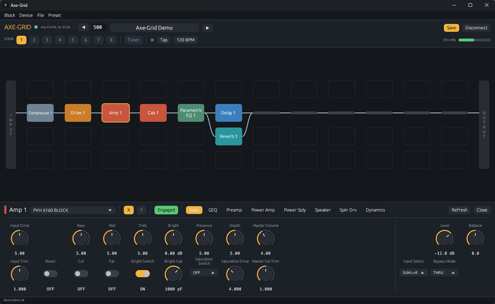
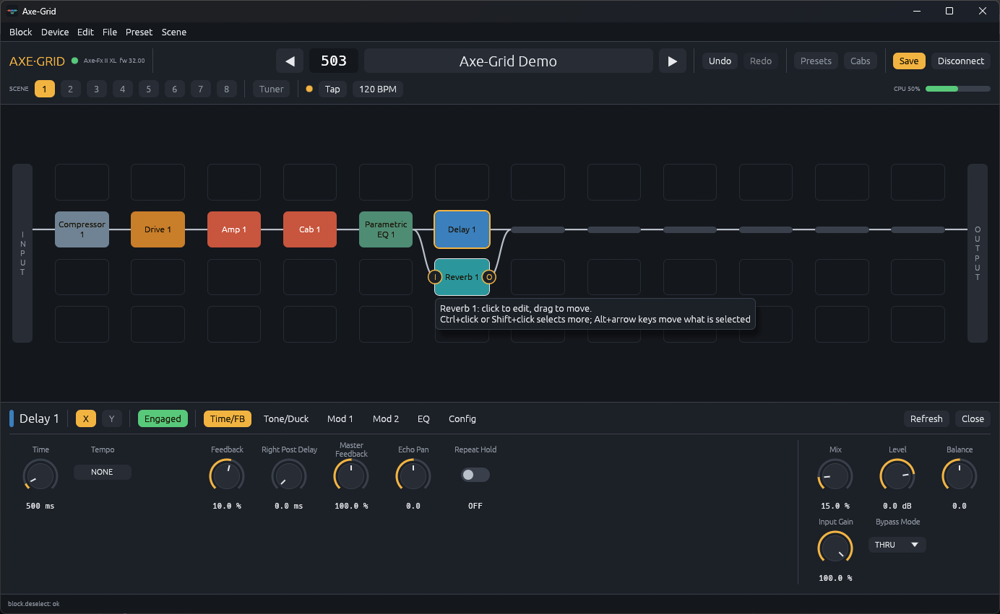
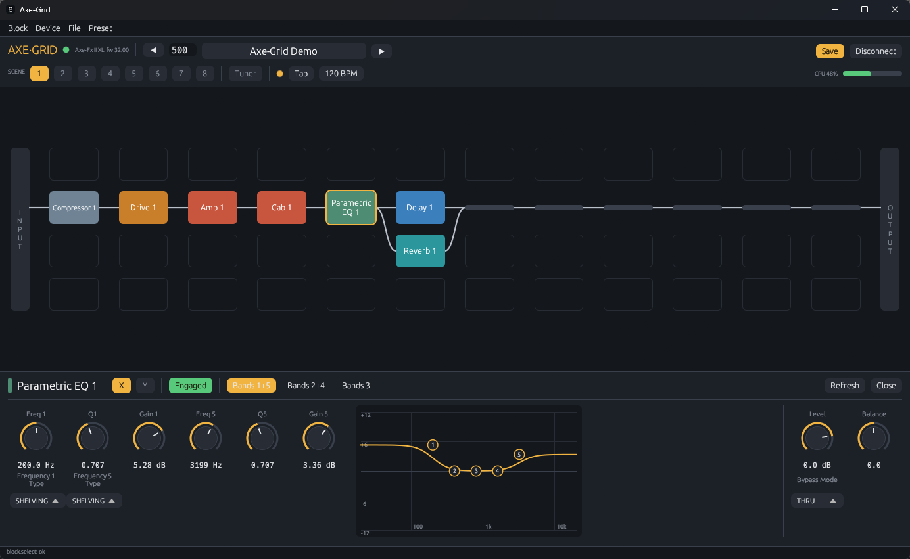
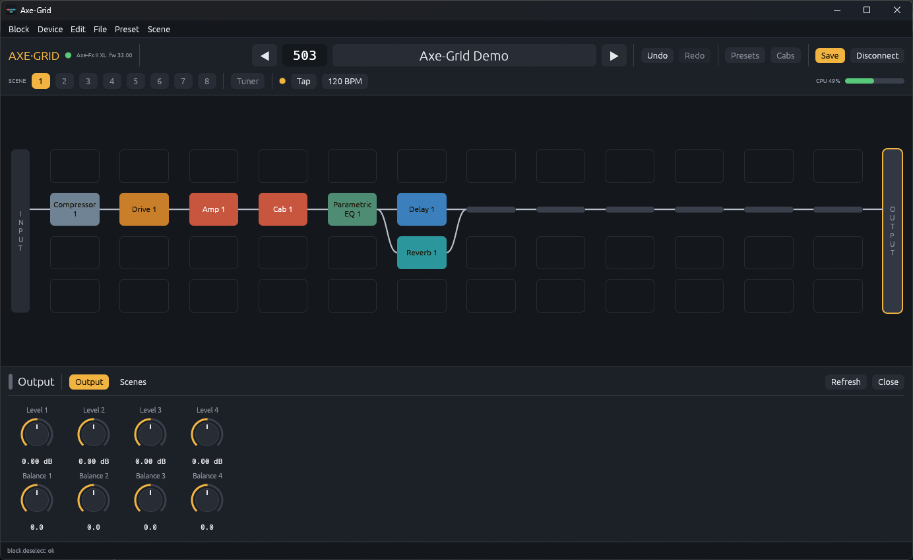
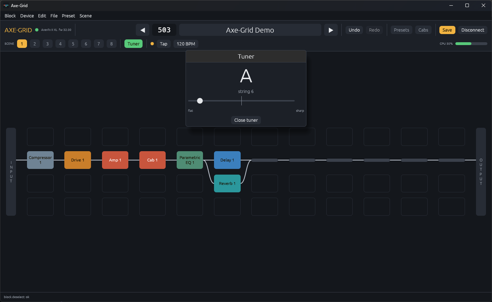

<p align="center">
  
</p>

<h1 align="center">Axe-Grid</h1>

<p align="center">
  <b>An open-source editor for the Axe-Fx II, rebuilt from scratch in pure Rust.</b><br>
  The routing grid, every block's pages and knobs, scenes, X/Y, tuner, tempo and looper,<br>
  in a small native app for Windows, macOS and Linux. Free, offline, and yours.
</p>

<p align="center">
  
  
  
  
  <a href="https://github.com/RamonWide/axe-grid/actions/workflows/ci.yml"></a>
</p>

<br>

<p align="center">
  
  <br>
  <sub>A preset on the routing grid, with the amp block's Basic page open. Captured from the real app, connected to an Axe-Fx II XL.</sub>
</p>

<p align="center">
  <a href="#install">Install</a> ·
  <a href="#features">Features</a> ·
  <a href="#everything-in-the-box">Everything in the box</a> ·
  <a href="#built-for-agents">Agents</a> ·
  <a href="#under-the-hood">Under the hood</a> ·
  <a href="#build-from-source">Build from source</a> ·
  <a href="ROADMAP.md">Roadmap</a> ·
  <a href="CONTRIBUTING.md">Contributing</a>
</p>

> [!IMPORTANT]
> **Status: early alpha.** Axe-Grid edits presets on real hardware today, but it is not yet a
> replacement for the original editor: modifiers are new and confirmed on a unit for one parameter
> only, and there are no global settings and no meters. It has been tested on one Axe-Fx II XL (firmware 32.00) on Windows; the macOS and Linux
> builds compile from the same code but nobody has run them against a unit yet.
> [ROADMAP.md](ROADMAP.md) says exactly where things stand. Back up your presets before pointing
> any new editor at an instrument you depend on.

<br>

<table>
  <tr>
    <td width="25%" valign="top">
      <h3>🎛️ Familiar by design</h3>
      Preset and scenes across the top, the 12×4 grid in the middle, the selected block's pages underneath. Every control is on the page and row where your hands expect it.
    </td>
    <td width="25%" valign="top">
      <h3>⚡ Small and native</h3>
      One executable of a few megabytes. No runtime, no web view, no drivers or services. Starts in a moment and stays out of the way.
    </td>
    <td width="25%" valign="top">
      <h3>🔌 Any MIDI port</h3>
      Talks to the unit over whatever MIDI port your computer offers: USB where the system provides one, or a plain 5-pin MIDI interface.
    </td>
    <td width="25%" valign="top">
      <h3>🤖 Agent-ready</h3>
      Every action is a command, so the same engine can be driven from the window, the command line, a JSON control channel or an MCP server.
    </td>
  </tr>
</table>

<br>

## Install

No programming tools are needed. Pick your system, download one file, and run it.

1. Open the **[latest release](https://github.com/RamonWide/axe-grid/releases/latest)**.
2. Download the file for your computer:

   | Your computer | Download | Then |
   |---|---|---|
   | **Windows** 10 or 11 | `axe-grid-<version>-windows-x64.zip` | Unzip it, open the folder, double-click `axegrid-setup.exe`: it puts Axe-Grid on your desktop and in the Start menu. (Or just run `axegrid.exe` from the folder.) |
   | **Mac** (Apple silicon or Intel) | `axe-grid-<version>-macos-universal.zip` | Unzip it, drag **Axe-Grid** to Applications, then right-click it and choose **Open** the first time |
   | **Linux** (64-bit Intel/AMD) | `axe-grid-<version>-linux-x86_64.tar.gz` | Unpack it and run `./axegrid` |
   | **Linux** (64-bit ARM) | `axe-grid-<version>-linux-aarch64.tar.gz` | Unpack it and run `./axegrid` |

3. Connect your Axe-Fx II and switch it on, then start Axe-Grid. It looks for the unit by itself,
   on USB first and then on your MIDI interfaces. If it does not find it, press **Find my Axe-Fx**,
   or choose the MIDI ports at the top of the window and press **Connect**. No unit at hand? Press
   **Simulator** to look around.

Windows and macOS will warn you the first time, because the builds are not yet signed with a paid
certificate. The step-by-step guide shows what to click, how to connect the unit, and what to do
when it is not found: **[docs/install.md](docs/install.md)**.

## Features

Every screenshot here is the real app, connected to an Axe-Fx II XL.

<table>
  <tr>
    <td width="50%" valign="top">
      
      <br>
      <sub>Hovering a block shows its input and output handles. Below, the delay's first page.</sub>
      <h3>Route it the way you think</h3>
      Place blocks on the 12×4 grid, drag them to another cell, and cable them by clicking one block's <b>O</b> and the next block's <b>I</b>. Click a handle and then the <b>INPUT</b> or <b>OUTPUT</b> bar and Axe-Grid lays the shunts along the row for you.
      <br><br>
      Series, parallel, split and merge: the grid shows what the unit holds, read back after every change.
    </td>
    <td width="50%" valign="top">
      
      <br>
      <sub>The Parametric EQ's curve follows the knobs as you turn them.</sub>
      <h3>Every page, every knob</h3>
      38 block types, each with its pages laid out in rows of knobs, switches, lists and faders, with the unit's own display text under every control. Level, balance and bypass mode sit on the right of every page.
      <br><br>
      Drag a knob or turn the mouse wheel over it; hold Shift for fine steps. Pages size themselves to fit, so there is nothing to scroll.
    </td>
  </tr>
  <tr>
    <td width="50%" valign="top">
      
      <br>
      <sub>Click the OUTPUT bar for the output mixer, or the INPUT bar for the input noise gate.</sub>
      <h3>The whole signal path</h3>
      The input noise gate and the output mixer open from the bars at either end of the grid, with per-row levels and balance and their per-scene settings.
      <br><br>
      Eight scenes on one row of buttons, X/Y on every block that has it, and bypass with a click.
    </td>
    <td width="50%" valign="top">
      
      <br>
      <sub>The tuner, shown here with no instrument plugged in.</sub>
      <h3>The top bar you reach for</h3>
      Preset number and name, scenes, <b>Tuner</b>, <b>Tap</b> tempo with a beat light, an editable BPM, and a CPU meter that updates as you add blocks.
      <br><br>
      Looper transport buttons light up from the unit's own status, and Tone Match starts both captures with one press.
    </td>
  </tr>
</table>

<br>

## Everything in the box

<table>
  <tr>
    <td width="33%" valign="top">
      <h4>🧱 Presets and scenes</h4>
      Step through presets or jump to a number · rename · save, with a confirmation that names the slot being overwritten · a browser of every slot with search, copy, export, import and backup · eight scenes · tempo, tap and CPU load.
    </td>
    <td width="33%" valign="top">
      <h4>🔀 Grid</h4>
      Place, move and remove blocks and shunts · cable and uncable cells · one-click runs to the input and the output · cables follow a block moved within its column.
    </td>
    <td width="33%" valign="top">
      <h4>🎚️ Blocks</h4>
      Pages for 38 block types · bypass and X/Y · knobs, faders, switches and lists with the unit's display text · amp, cab and effect type lists read from your unit · undo and redo · curves for the EQs, filter, compressor, gates and more · looper and Tone Match buttons.
    </td>
  </tr>
  <tr>
    <td width="33%" valign="top">
      <h4>📦 User cabs</h4>
      On an XL or XL+: the names of all 1024 user cabs · export to a file · import a file into a slot · try a cab in the preset's cab block. Import is new and not yet confirmed on a unit.
    </td>
  </tr>
  <tr>
    <td width="33%" valign="top">
      <h4>🧪 Simulator</h4>
      A built-in stand-in device with three presets. Try the whole editor, write scripts and run the test suite with nothing plugged in.
    </td>
    <td width="33%" valign="top">
      <h4>🛟 Careful with your unit</h4>
      Edits go to the unit's edit buffer, exactly like turning its front-panel knobs. Nothing is written to a preset slot until you press Save and confirm.
    </td>
    <td width="33%" valign="top">
      <h4>📖 An open protocol spec</h4>
      <a href="spec/SPEC.md"><code>spec/SPEC.md</code></a> documents the Axe-Fx II SysEx messages Axe-Grid uses, each fact tagged with how it was verified, for anyone building their own tools.
    </td>
    <td width="33%" valign="top"></td>
    <td width="33%" valign="top"></td>
  </tr>
</table>

New and still to be confirmed on a unit: scene and block copy and paste, the looper's position bar
and the Tone Match steps; modifiers on more than the one parameter they were checked on. Not there yet: resetting a block, bank files, meters and
global settings.
The full list, ranked, is in [ROADMAP.md](ROADMAP.md).

## Built for agents

Every menu item, button, knob and shortcut runs a command from one registry of 83 commands
([`docs/commands.md`](docs/commands.md)). The window, the CLI, the JSON control channel and the MCP
server all call the same commands, so anything you can click, a script or an AI agent can do too.

```sh
# List every command with its parameters, as JSON
axegrid-cli commands

# Try a command against the built-in simulator
axegrid-cli --simulator run block.select '{"block":"Amp 1"}'

# Run a list of steps from a file
axegrid-cli batch steps.json

# Let an agent drive it over MCP (headless, or bridged to the running window)
axegrid-cli --simulator mcp
```

The desktop app also offers an authenticated, loopback-only control channel
(`axegrid --control <port> --control-token-file <path>`), so a script or agent can drive the window
you are looking at. See [`docs/control-protocol.md`](docs/control-protocol.md) and
[`docs/mcp.md`](docs/mcp.md).

## Under the hood

- **Engine first:** editor state and a command registry, with a thin egui window on top. Six crates
  in strict layers, from SysEx framing up to the UI ([`docs/architecture.md`](docs/architecture.md)).
  The engine talks to the unit on a thread of its own, so a slow or silent unit never freezes the
  window.
- **Never crash:** no `unsafe`, and no `unwrap`, `expect` or `panic!` outside tests. A device that
  answers garbage, or not at all, produces an error message, not a crash.
- **Tested without hardware:** 187 tests run against the simulated device, including hostile
  command parameters and literal bytes captured from a real unit.
- **Clean-room:** written from a functional specification and observed behaviour. No code, artwork,
  fonts or skins from the original editor ([`docs/clean-room.md`](docs/clean-room.md) lists
  the two data files that originate in the original).
- **Evidence over guesses:** every wire-format fact in the spec carries a confidence tag, and what
  has and has not been checked on hardware is listed in [`docs/gaps.md`](docs/gaps.md).

## Build from source

You need [Rust](https://rustup.rs) 1.95 or newer. On Linux, also install the ALSA headers
(`sudo apt install libasound2-dev pkg-config` on Debian and Ubuntu; other distributions are in
[CONTRIBUTING.md](CONTRIBUTING.md#set-up)).

```sh
git clone https://github.com/RamonWide/axe-grid
cd axe-grid
cargo run --release -p axegrid     # the desktop app; press "Simulator" to try it
cargo test --workspace             # the test suite; no hardware needed
```

New contributors and AI agents: start with [`AGENTS.md`](AGENTS.md), then
[CONTRIBUTING.md](CONTRIBUTING.md).

## Documentation

| For | Read |
|---|---|
| Installing and first steps | [docs/install.md](docs/install.md) |
| Where the project stands | [ROADMAP.md](ROADMAP.md), [docs/gaps.md](docs/gaps.md), [CHANGELOG.md](CHANGELOG.md) |
| Contributing | [CONTRIBUTING.md](CONTRIBUTING.md), [AGENTS.md](AGENTS.md), [CODE_OF_CONDUCT.md](CODE_OF_CONDUCT.md) |
| How it is built | [docs/architecture.md](docs/architecture.md), [spec/SPEC.md](spec/SPEC.md), [docs/clean-room.md](docs/clean-room.md) |
| Scripting and agents | [docs/commands.md](docs/commands.md), [docs/control-protocol.md](docs/control-protocol.md), [docs/mcp.md](docs/mcp.md) |
| Security | [SECURITY.md](SECURITY.md) |
| Making a release | [docs/releasing.md](docs/releasing.md) |

## Getting help

- **Something does not work:** [open a bug report](https://github.com/RamonWide/axe-grid/issues/new/choose).
  Say which Axe-Fx II model and firmware you have, and which operating system.
- **You own a unit and want to help:** the most useful thing is to confirm how your model behaves.
  See [Hardware reports](CONTRIBUTING.md#hardware-reports).
- **Questions and ideas:** [Discussions](https://github.com/RamonWide/axe-grid/discussions).

---

## License and credits

Axe-Grid is released under the [MIT License](LICENSE). Copyright (c) 2026 The Axe-Grid contributors.

Every file not written for this project is listed with its origin in
[ATTRIBUTION.md](ATTRIBUTION.md). The app icon and all interface artwork are original to this
project.

<sub>Axe-Fx, Axe-Edit and Fractal Audio are trademarks of Fractal Audio Systems, LLC. Axe-Grid is an independent, open-source project and is not affiliated with, sponsored by or endorsed by Fractal Audio Systems; these names are used only to describe the hardware it works with. Axe-Grid comes with no warranty: you use it with your own equipment at your own risk.</sub>
